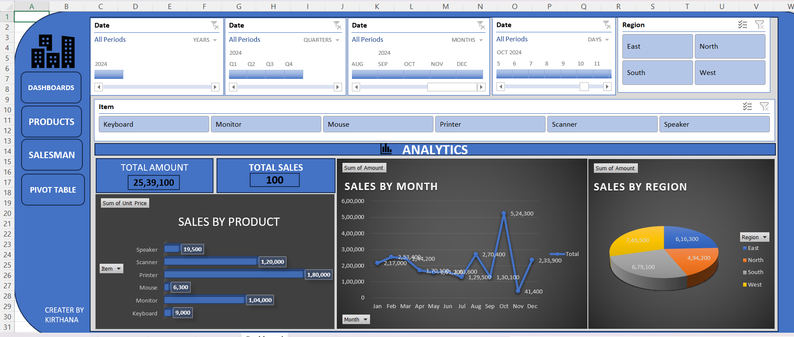
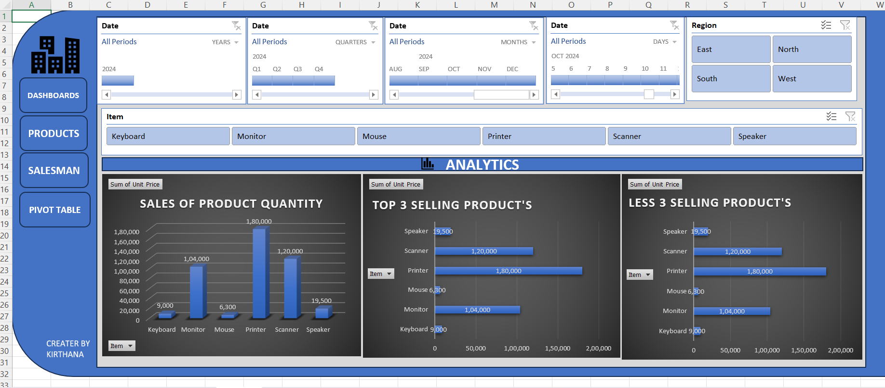
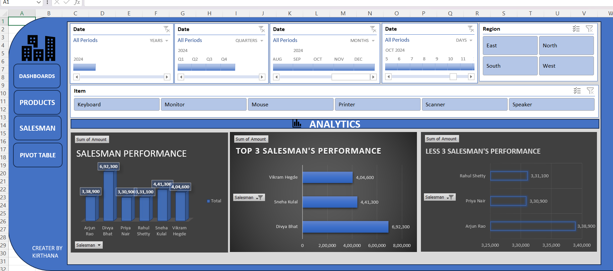

# Excel Sales Dashboard

An Excel-based sales analysis project that uses pivot tables, charts and slicers to analyze sales orders by salesman, region, product and month.

## Project Overview

This project analyzes **100 sales orders from January to December 2024** with a total sales value of **₹25,39,100**. The goal is to understand who is selling the most, which products earn the most revenue, and how sales change across regions and months.

## Files

| File | Description |
|------|-------------|
| `SALES.xlsx` | Excel workbook with the dataset, pivot tables and dashboard |

## Workbook Sheets

| Sheet | What it contains |
|-------|------------------|
| **Dataset** | Raw order data (100 rows) with a total amount summary |
| **Pivot table** | Pivot tables summarizing amount, quantity and unit price |
| **Sales man** | Charts showing performance of each salesman |
| **Products** | Charts showing sales by product |
| **Dashboard** | Final dashboard with charts and slicers |

## Dataset Columns

| Column | Description |
|--------|-------------|
| Order ID | Unique order number (e.g. ORD1001) |
| Date | Date of the order |
| Month | Month of the order |
| Salesman | Name of the salesman |
| Region | East, West, North or South |
| Item | Product sold (Printer, Scanner, Monitor, Speaker, Keyboard, Mouse) |
| Quantity | Number of units sold |
| Unit Price | Price per unit (₹) |
| Amount | Total order value = Quantity × Unit Price |

## Key Insights

- **Top region:** West leads with ₹7,49,500 in sales, followed by South and East.
- **Top salesman:** Divya Bhat is the highest performer with ₹6,92,300.
- **Top product:** Printers bring in the most revenue (₹10,68,000), followed by Scanners and Monitors.
- **Best month:** October had the highest sales (₹5,24,300), while November was the lowest (₹41,400).
- **Low-value items:** Mouse and Keyboard sell in good quantities but contribute little to total revenue.

## Dashboard Preview

### Main Dashboard

### Product Dashboard

### Salesman Dashboard

## Tools Used

- Microsoft Excel
- Pivot Tables
- Charts
- Slicers

## How to Use

1. Download `SALES.xlsx` from this repository.
2. Open it in Microsoft Excel.
3. Go to the **Dashboard** sheet and use the slicers to filter the data.

## Author
kirthana739
